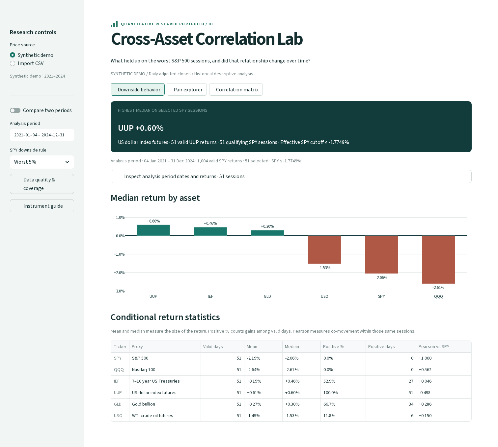

# Cross-Asset Correlation Lab

**On the S&P 500's worst trading days, which assets gained, how often, and did the answer change across periods?** This first project in a quantitative research portfolio studies six US-listed instruments using daily adjusted closing prices. The opening screen ranks their median returns on days selected by SPY.



## Run the demo

Use Python 3.12. From the project directory, run these commands on macOS or Linux.

```bash
python3.12 -m venv .venv
source .venv/bin/activate
python -m pip install -r requirements.txt
streamlit run app.py
```

Open the local address printed by Streamlit. The first installation needs internet access. After installation, the demo, charts, calendar and CSV import run offline without credentials.

## Read the first result

The **synthetic demo** covers 4 January 2021 through 31 December 2024. The worst 5% rule selects **51 of 1,004 valid SPY returns**. UUP has the highest median, **+0.60%**, and finishes positive on **51 of 51** selected days. Its within-sample Pearson correlation with SPY is **−0.498**. The median measures a typical daily outcome in this sample. The correlation measures how the two returns varied together around their respective sample means.

Open **Inspect analysis period dates and returns** to check every observation, sorted by SPY loss. The downloadable CSV retains decimal returns at calculation precision. Enable **Compare two periods** to see the deliberately engineered shift in Treasury behavior.

| Synthetic SPY tail sample | SPY cutoff, rounded | Valid IEF days | IEF median return | IEF positive days |
|---|---:|---:|---:|---:|
| 2021–2022 | −1.78% | 26 | +1.09% | 26 / 26 |
| 2023–2024 | −1.71% | 26 | −0.80% | 0 / 26 |

Each period has its own relative cutoff. The periods can therefore select a different set of days from the pooled sample. Use a fixed decline to compare responses to the same absolute SPY loss. These numbers demonstrate the software using fictional prices. Historical market conclusions require sourced adjusted prices.

## Research views

| View | Question | What to inspect |
|---|---|---|
| Downside behavior | What happened when SPY was weak? | Mean, median, positive share and count, Pearson correlation with SPY, dates and valid returns. Compare any two inclusive periods. |
| Pair explorer | Did the relationship persist as market conditions changed? | Pearson or Spearman, 20/60/252-session rolling estimates with a zero line, paired daily scatter, full-period estimate and latest valid interval for each window. |
| Correlation matrix | Which relationships change in the SPY tail? | Choose assets, method and sample. Each cell displays the coefficient and its pair count on a fixed −1 to +1 scale. N/D cells have an accompanying reason. |

## Instruments and interpretation

All prices refer to US-listed shares in USD. The issuer pages describe the instruments and do not supply prices to this app.

| Ticker | Exposure | Interpretation and source |
|---|---|---|
| SPY | S&P 500 equities | Broad US large-cap equity proxy and event selector. [State Street](https://www.ssga.com/us/en/intermediary/etfs/state-street-spdr-sp-500-etf-trust-spy) |
| QQQ | Nasdaq-100 equities | Large nonfinancial Nasdaq-listed companies. Sector weights differ from SPY. [Invesco](https://www.invesco.com/qqq-etf/en/home.html) |
| IEF | US Treasuries, 7–10 years | Measures the return on bonds with intermediate duration. A gain is a rise in the fund's adjusted share price. [iShares](https://www.ishares.com/us/products/239456/ishares-710-year-treasury-bond-etf) |
| UUP | Long US dollar index futures | Basket exposure against six currencies. Futures pricing, collateral income, rolling and expenses influence the return. A bilateral FX rate can behave differently. [Invesco](https://www.invesco.com/us/en/financial-products/etfs/invesco-db-us-dollar-index-bullish-fund.html) |
| GLD | Gold bullion | The trust holds physical gold. Expenses and share pricing can create differences from bullion returns. [SPDR Gold Shares](https://www.spdrgoldshares.com/usa/) |
| USO | WTI crude oil futures | Futures exposure is rolled. The term structure, contract holdings, collateral and expenses can produce material differences from spot WTI. [USCF](https://www.uscfinvestments.com/uso) |

US closing prices give the six instruments a common observation time. ETF and commodity-pool share returns include tracking differences and fees. Use a consistent adjustment methodology across instruments, including splits and cash distributions where applicable.

## Import adjusted prices

Choose **Import CSV**. Supply a UTF-8, comma-separated file with exactly the seven named columns, in any order. Use a decimal point, positive finite prices and one row per US equity session. Rows can arrive unsorted. Leave a missing quote blank or use `NA` or `N/A`.

```csv
date,SPY,QQQ,IEF,UUP,GLD,USO
2021-01-04,100.00000000,100.00000000,100.00000000,100.00000000,100.00000000,100.00000000
2021-01-05,100.33406818,100.03659582,99.95906070,100.29572084,100.46072292,101.03806367
```

These are synthetic rows. Use the [header template](data/template.csv) or try the [12-row synthetic example](data/example_prices.csv). The sidebar reports missing session dates, missing quotes and valid return counts. Two adjacent prices produce one return. Import longer histories for rolling estimates. Uploaded files are processed in the running Streamlit session and the application writes no uploads to disk. On a hosted instance the upload is sent to that server.

## Methodology

- **Calendar and returns.** The app sorts dates and reindexes prices to every XNYS session between the first and last supplied dates. Weekends and exchange holidays are excluded. Daily simple return is `r[t] = P_adj[t] / P_adj[t−1] − 1`, where the denominator is the previous scheduled session's price. A missing session or quote invalidates both adjacent returns for the affected instrument. No forward-fill or multi-session bridging is applied. The first price row has no return.
- **Period boundaries.** Both endpoints are inclusive. Returns are assigned to their end date and computed before filtering, so the first selected session can use a previous close already present in the dataset. Rolling windows use only return dates inside the selected period.
- **Tail rule.** With N valid SPY returns, select the lowest `ceil(q × N)` returns for q = 5% or 10%. The effective cutoff is the final selected rank. Include every tie at the cutoff. Short or tied samples can therefore exceed the requested fraction. The relative rule can include flat or positive days in an unusually strong period. The fixed rule uses `SPY return ≤ −p/100`. Selection and summaries use unrounded values.
- **Denominators.** Each asset uses its valid returns on qualifying SPY dates. Positive share is `count(return > 0) / valid asset days`. A flat return is a valid day without a gain. Pairwise deletion allows different cells in the same matrix to have different counts. The resulting matrix can be unsuitable for portfolio optimization.
- **Correlation.** Pearson uses paired return values. Spearman applies Pearson to average ranks with ties, recomputed within each pair and each window. A coefficient needs at least three complete pairs and variation in both columns. A mean or median needs one valid return. N/D indicates an unavailable estimate.
- **Rolling estimates.** Each point requires 20, 60 or 252 consecutive scheduled return observations for both assets. Missing data and constant series interrupt the line. The latest valid window can end before the period ends. If no valid window exists, the table reports the count and interval of the last attempted window.
- **Statistical limits.** Conditioning on a narrow SPY tail restricts its range and can materially change a coefficient. A high positive-day share can coexist with a negative mean if losses are large. Overlapping rolling windows share observations. The analysis is descriptive and provides neither causal identification nor a forecast.

## Provenance, verification and deployment

The application code, tests, simulated prices and screenshot were created for this project. `scripts/generate_demo.py` generates the two-regime sample with NumPy seed 701. Its IEF equity-factor loading changes sign in January 2023. The app reads the committed fixture directly. Regenerate it with `python -m scripts.generate_demo`.

External resources are the separately installed Python packages in [requirements.txt](requirements.txt), the XNYS schedule supplied by [exchange_calendars](https://github.com/gerrymanoim/exchange_calendars), and the linked issuer descriptions. The repository includes **no third-party price history** or download integration. Import a dataset you are permitted to use. To publish empirical findings, record the provider, retrieval date, adjustment convention and date coverage and check redistribution rights separately.

```bash
python -m unittest discover -s tests -v
```

The suite checks known returns and correlations, strict rolling windows, missing quotes and sessions, exceptional exchange closures, ties, zero variance, table reconciliation, demo ranking, date controls and view changes. The browser flow was also exercised against a running Streamlit server. Runtime dependencies are pinned for Python 3.12, including transitive dependencies and platform markers. Direct pins are in `requirements.in`.

For a public repository, upload the contents of this directory, including `.gitignore` and the public theme in `.streamlit/config.toml`. For Community Cloud, select the repository and branch, set the entry point to `app.py` (or its nested path in a portfolio monorepo), and choose Python 3.12 in the advanced settings. [Streamlit deployment guide](https://docs.streamlit.io/deploy/streamlit-community-cloud/deploy-your-app)
